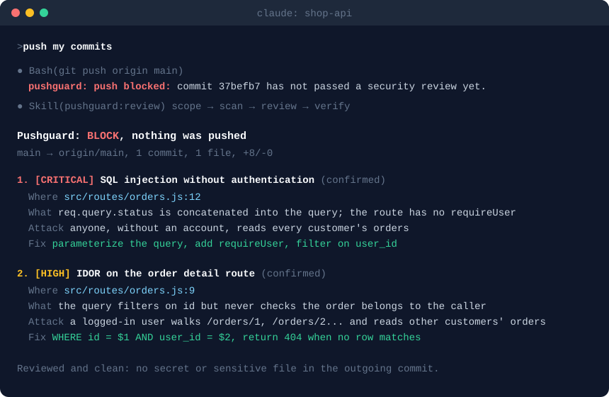

# Pushguard

A security gate for `git push`, for [Claude Code](https://claude.com/claude-code).

When Claude is about to push, Pushguard stops the push, makes Claude review the outgoing
commits for security problems, and only lets the push through once the review passes.



<sub>Abridged and translated from a real session on a test repository. The IDOR is a missing
ownership check: no pattern scanner can see it.</sub>

```
you: "push this"
  -> Claude runs git push
  -> pushguard hook: blocked, commit a1b2c3d4 has not been reviewed
  -> Claude runs the pushguard:review skill
       scope   exactly which commits and files would be published
       scan    secrets in every outgoing commit, sensitive files, risky patterns
       review  auth, injection, XSS, CORS, CSRF, RLS, uploads, webhooks, CI, dependencies...
       verify  each finding is traced and challenged before it is reported
  -> verdict PASS / WARN: gate opens, push goes through
     verdict BLOCK: findings with file:line, attack scenario and fix. No push.
```

## What it checks

| Area | Examples |
|---|---|
| Secrets | 30+ credential formats, `.env` and key files, **including secrets deleted in a later commit** (they are still pushed) |
| Authentication and access control | missing auth on routes and server actions, IDOR, multi-tenant leaks, mass assignment, JWT and OAuth mistakes, sessions |
| Database policies | Supabase / Postgres RLS, `SECURITY DEFINER`, grants, Firebase rules |
| Injection | SQL, NoSQL, command, path traversal, SSRF, deserialization, XXE, SSTI, prototype pollution, ReDoS |
| Web client | XSS, CSRF, CORS, CSP and security headers, cookies, open redirects, clickjacking, postMessage |
| API and data | validation, rate limiting, uploads, webhooks, error and log leakage, GraphQL, race conditions, payment logic, caching |
| Supply chain and infrastructure | dependencies and typosquats, lockfiles, GitHub Actions, Docker, Terraform, deployment config |
| AI / LLM | prompt injection, agent tools, output handling, key exposure, MCP and agent configs |
| Frameworks | Next.js, React, Supabase, Firebase, Express, NestJS, tRPC, Prisma, Django, Flask/FastAPI, Rails, Laravel, Go, Spring, mobile, serverless |

## Install

```
/plugin marketplace add Munkkkk/pushguard
/plugin install pushguard@pushguard
```

That is all for pushes made by Claude. To also protect pushes from your terminal or IDE, ask
Claude to "set up pushguard in this repo" (or run `/pushguard:setup`): it installs a native
git pre-push hook that blocks secrets.

Requirements: git and bash (on Windows, Git Bash, which ships with Git for Windows).
No other dependency.

## Use

- **Automatic**: ask Claude to push. The gate does the rest.
- **On demand**: `/pushguard:review` reviews the outgoing commits now.
- **Since a revision**: `/pushguard:review --from main`
- **Full audit** of an existing project: `/pushguard:review --full`

Approvals are tied to one commit. A new commit, an amend or a rebase needs a new review;
only the commits added since the last approval are examined.

## How it is built

| Part | Role |
|---|---|
| `hooks/hooks.json` + `scripts/gate.sh` | `PreToolUse` hook. Blocks `git push` unless `HEAD` has an approval marker in `.git/pushguard/`. Also blocks `commit && push` one-liners, which cannot have been reviewed. |
| `skills/review` | The review method, and one reference file per area, loaded only when the change calls for it. |
| `scripts/scope.sh` | Works out what the push would publish and which areas the changed files point to. |
| `scripts/scan.sh` + `scripts/rules/` | Deterministic scan: secrets (blocking) and risky patterns (leads for the reviewer). Plain `grep -E` rules, easy to extend. |
| `scripts/approve.sh` | Opens the gate for the reviewed commit. Re-runs the secret scan and refuses if a secret is still there. |
| `agents/auditor.md` | Read-only subagent, one per area, for large diffs and full audits. |
| `skills/setup` + `scripts/git-pre-push.sh` | Optional native git hook for pushes outside Claude Code. |

## Configure

- `.pushguardignore`: globs the secret scan skips (test fixtures with fake keys).
- `// pushguard:ignore` on a line: silence that line.
- `.pushguard.md`: your threat model and accepted risks. The reviewer reads it first.
- **Blocking threshold**: asked when you enable the plugin, `high` by default (CRITICAL and
  HIGH block). Set `medium` for a strict team, `critical` for a prototype. A secret always blocks.
- **Documentation fast path**: a push that only touches prose and images (`.md`, `.txt`,
  images, `LICENSE`...) passes on the secret scan alone, without a review. Agent instruction
  files (`CLAUDE.md`, `AGENTS.md`, skills, `.claude/`, `.github/`) never take the fast path.
  `PUSHGUARD_NO_FASTPATH=1` turns it off.
- `PUSHGUARD_SKIP=1 git push`: skip the gate once. `PUSHGUARD_DISABLE=1`: disable it.
- Add your own rules to `scripts/rules/secrets.rules` and `scripts/rules/leads.rules`.

## Limits, honestly

- Pushguard is a guard rail, not a sandbox. It catches unreviewed pushes and makes the
  review happen; someone determined to bypass it can. The escape hatches are documented
  on purpose.
- The review is done by a language model. It finds a lot, including the missing-check bugs
  that scanners cannot see, but it can miss things and can be wrong. It complements code
  review, tests, dependency scanning and a real penetration test. It replaces none of them.
- The Claude Code gate only sees pushes made through Claude Code. Install the native hook
  for the rest; that hook only checks for secrets.
- The gate judges the repository it is run from. Exotic invocations (pushing another
  repository through a script, aliases that hide `git push`) are not detected.

## Develop

```bash
claude --plugin-dir ./pushguard     # load the plugin from a local checkout
claude plugin validate ./pushguard  # check the manifest
bash scripts/scan.sh --all          # run the scanner on any repository
bash tests/run.sh                   # test suite (also run by CI on Linux, macOS and Windows)
```

## License

MIT
